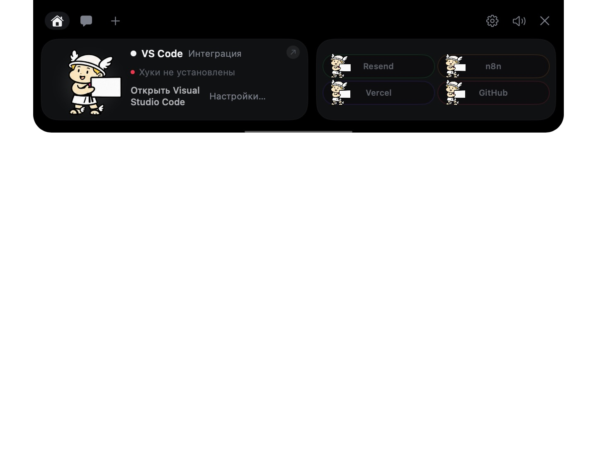

# NIBS Гермесик

Гермесик — фирменный помощник NIBS для выреза экрана Mac. Показывает состояние AI-агентов, запросы разрешений и результаты работы. Основан на открытом коде Coucou; вместо квадратного Mochi использует оригинального Гермесика NIBS.

- [Интерактивный предпросмотр на сайте](https://nibs.shinobi-so-standom.chatgpt.site/demo)
- [Репозиторий](https://github.com/shinobiSoStandom/nibs-germesik-)
- [Материалы NIBS на Google Диске](https://drive.google.com/drive/folders/1wI12XEQN5AAPFE8qeERLq9d5wuZb8BVq)

## Версия NIBS 3.0

Отдельное имя приложения и идентификатор `com.nibs.germesik`; оригинальная иллюстрация Гермесика вместо upstream-персонажа; фирменные иконки; собственные синтезированные звуки. Сохранены нативное окно у выреза экрана, состояния агента и явное подтверждение действий. Обновления из Coucou отключены. Настройки другого приложения не перезаписываются.

Браузерная демонстрация показывает взаимодействие с помощником. Она не управляет агентами на компьютере. Реальное наблюдение за агентами выполняет нативное приложение после настройки соответствующих подключений.

## Скриншот нативного приложения



Проверено 25 октября 2026: сборка Xcode для macOS arm64 завершилась успешно, приложение запущено, открыты основное окно и панель у выреза экрана. Интеграции с реальными агентами, диктовка, микрофон и запись встреч в этой проверке не включались. Хуки требуют отдельной настройки пользователем.

## Сборка для Mac

macOS 15+, Xcode и XcodeGen:

```sh
brew install xcodegen
bash scripts/build-nibs.sh
```

Приложение: `.nibs-build/Build/Products/Debug/NIBS Germesik.app`. Используйте `NotchBuddy/nibs-project.yml` — это профиль NIBS без команды разработчика и облачных разрешений автора upstream. Сборка локальная, без подписи Developer ID и нотарификации; готового подписанного установщика пока нет. Загрузка моделей диктовки и настройка сервисов выполняются отдельно пользователем.

Скрипт использует `-packageAuthorizationProvider netrc -scmProvider system` и отключает Git credential helper при загрузке публичной зависимости: Xcode не запрашивает пароль от связки ключей GitHub. FluidAudio закреплён на `v0.17.7` (`503b4bd1bbf7220882de39fe8ae6716aae4132da`). Ключи приложения хранятся только в собственном сервисе `com.nibs.germesik`; фоновые чтения не показывают системный диалог. Данные и сокет — в `Application Support/NIBSGermesik`.

Для автономного нативного предпросмотра без подключения сервисов:

```sh
open ".nibs-build/Build/Products/Debug/NIBS Germesik.app" --args --nibs-preview
```

Перед повторной сборкой закройте приложение. По умолчанию запуск в фоне и на входе в систему не устанавливается.

`NotchBuddy/Sources/App` — macOS; `Sources/CoucouKit` — общий движок; `Assets.xcassets/Hermesik.imageset` — исходный маскот; `Resources/sounds` — собственные звуки. Имена внутренних типов и совместимые протоколы хуков сохранены, чтобы не ломать интеграции. Непроверенные платформы Windows/Linux/Android/iOS сохранены как upstream-код, не объявлены релизами NIBS.

## Происхождение и лицензия

Код основан на [Louis-CFM/coucou](https://github.com/Louis-CFM/coucou), MIT. Авторство сохранено в [LICENSE](LICENSE). Условия оригинального персонажа и медиаматериалов — [LICENSE-ASSETS.md](LICENSE-ASSETS.md). NIBS-сборка заменяет его персонажа, иконки и звуки собственными; upstream-материалы `docs/media` и `design` являются исторической документацией и не входят в дистрибутив приложения.

Гермесик взят из оригинальных материалов сайта NIBS: `public/assets/hermesik-presenting.png`. Права на бренд NIBS и его маскота не передаются лицензией MIT исходного кода Coucou.
